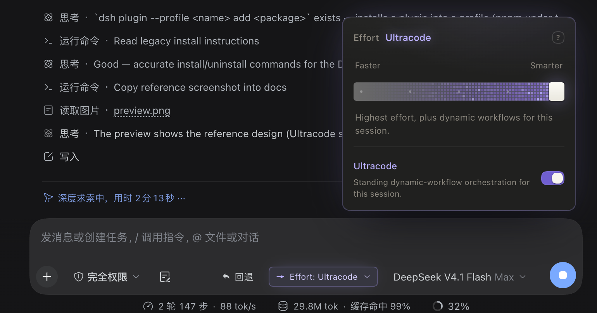

# dsh-claude-effort-slider

> A Claude Desktop–style **Effort** slider for [DeepSeek Harness](https://github.com/deepseek-ai/deepseek-harness).
> It replaces the composer's Effort switch with a draggable five-level control — **Low / Medium / High / Max / Ultracode** —
> including the Ultracode WebGL2 energy grid. **Ultracode always drives the model's maximum thinking effort.**

[](#install)
[](#what-it-does)
[](#project-layout)

**English** · [中文](#中文)



*Running in DeepSeek Harness: the `Effort: Ultracode` pill beside the model seat, and the popover with the Ultracode grid lit.*

---

## What it does

| Surface | Behaviour |
| --- | --- |
| Composer tool row | An `Effort: <level>` pill (gauge icon + label + chevron), violet and glowing at Ultracode |
| Click the pill | Opens the Effort popover above the composer card: Faster / Smarter, five stop dots, white pill thumb, per-level copy, the High-usage warning at Max, the Ultracode switch, the energy grid |
| The shipped **Effort / 推理等级** row in the model menu | Intercepted: it opens the popover instead of the level list, and the menu dismisses itself — the popover becomes the only surface on screen |
| ⌥ / ⌘ / Ctrl + click that row | Passes through, so the shipped level list (including `off`) stays reachable |

The effort value is written through the **same per-session model directory** the shipped menu and the
`/model` popup use (`ctx.modelDirectories.directoryFor(session).select(...)`), so a change from either side
shows up in the other. Only `reasoningEffort` is written — provider and model are untouched.

## The five levels → thinking effort

Level names are fixed (Claude's); the ladder comes from the model's own advertised reasoning efforts:

| Level | Writes |
| --- | --- |
| Low | `low` (then `minimal`, `medium`) |
| Medium | `medium` |
| High | `high` |
| Max | `max` (then `xhigh`, `high`) |
| **Ultracode** | **the top of the ladder** — the model's maximum thinking effort |

Name matching wins; when a catalog uses other names the five levels are spread by rank
(`round(i*(n-1)/4)`) and forced monotonic. `off` never enters the five levels: Claude's leftmost level is
Low, not off — reach `off` with ⌥/⌘/Ctrl-click or the `/model` popup.

On a `low / medium / high / max` ladder, Max and Ultracode write the same wire value; Ultracode additionally
means *this session runs in Ultracode mode*, remembered per session in
`localStorage["dsh-claude-effort:ultracode:<sessionId>"]`, so reopening the popover still sits on the far
right with the grid lit.

A model that advertises fewer than two thinking levels (or none) gets no pill; the popover explains why.

## Interaction

| Gesture | Result |
| --- | --- |
| Drag the thumb | Continuous follow; the level label updates live |
| Release | Spring snap to the nearest level (`stiffness 520 / damping 38`) and **one** write |
| Click the track / a stop dot | Jumps there and snaps |
| `← → ↑ ↓` | Step one level |
| `Home` / `End` | First / last level |
| `Enter` / `Space` | Snap the current position |
| Ultracode switch | On → far right, off → Max (one write each) |
| `Esc` / click outside | Closes |

Dragging only moves the picture; the write happens on settle, so a drag never floods the model RPC.

## Install

```sh
# CLI profile (web / tui / headless …)
dsh plugin --profile web add github:Ariakage/dsh-claude-effort-slider#main

# from a local checkout
dsh plugin --profile web add file:/path/to/dsh-claude-effort-slider
```

In the **Desktop app** the profile is managed by the app itself: install the repository (or the checkout
directory) through Plugin Manager, or from an agent session with
`plugin_manager install_bundle target=/path/to/dsh-claude-effort-slider`.

Then restart DeepSeek Harness, or refresh the window (`⌘R` / `Ctrl+F5`). There is no build step — the
browser half is a plain client bundle committed as `client.js`.

### Uninstall

```sh
dsh plugin --profile web remove dsh-claude-effort-slider
```

## Project layout

```text
client.js            browser half: pill, popover, WebGL2 grid, Effort-row interceptor
index.js             host half (no services, no config — the control lives in the browser)
cordis.patch.yml     bundle patch: inserts the `ui-claude-effort-slider` row
locale/{en,zh}.json  plugin inventory title / description
icon.svg             inventory artwork
test/smoke.mjs       render smoke test (window + React stubs, no browser)
docs/harness.png     the control running in DeepSeek Harness
```

The browser half registers two slot entries:

- `conversation.input.right` — the pill (session scoped, `order: 40`)
- `conversation.input.overlay` — the popover, floating inside the composer card (`order: 60`)

## 1:1 fidelity

Markup, class names (prefixed `ccs-`), numbers and copy are ported from the reference `index.html` /
`styles.css` / `app.js`:

- **Popover** 272px wide, 14px padding, 14px radius, `#20201f` surface, the same inset ring and drop shadows.
- **Track** 24px tall, 4px radius, `rgba(255,255,255,.1)`; the filled region is 26% white, turning violet at Ultracode.
- **Thumb** a 20×24 white pill with a 0.12s overshoot scale and a violet halo at Ultracode.
- **Stops** five 3px dots that scale to 1.35 on hover.
- **Text effects** the 220ms `opacity / translateY / blur` re-entry of the level label, the violet
  `text-shadow` on the label and the switch title at Ultracode, the amber warning line with its `!` badge at
  Max, the `?` hover tooltip, the muted `Effort` title.
- **Grid** `GRID_VS` / `GRID_FS` copied verbatim: 4px pitch, 3px cells with 0.9px corners, eight burst slots
  with a Manhattan wavefront, a five-step discrete ramp, breathing only on the hottest cells,
  `plus-lighter` with a left fade mask, 0.45s ignite / 0.85s cooldown.
- **Spring** `stiffness 520 / damping 38`, 6ms sub-steps.

Two deliberate deviations: the popover's entrance animation is 0.26s (the demo's 0.7s belongs to page load),
and the pill takes its colours from host theme tokens so it stays legible in a light palette; the popover
keeps the reference's literal colours.

## Verification

```sh
node --check client.js     # syntax
node test/smoke.mjs        # renders the pill and the popover with window/React stubs
```

- `test/smoke.mjs` asserts the module shape, both slot registrations, the pill label, the five stop dots, the
  slider's ARIA, the grid canvas, `Home → low`, `→ → medium`, `End → max` plus the Ultracode flag, the
  no-ladder state, and the Effort-row interception with the modifier-key pass-through.
- Installed on DSH Desktop and observed in the running window: the pill, the popover, the Ultracode grid and
  the effort write all work — the screenshot above is that window.

## Known limits

- The pill sits **left** of the model seat: `conversation.input.right` renders before `conversation.input.model`
  and the Harness exposes no additive seat after it. In Claude the effort pill is right of the model.
- The popover floats 10px above the composer card and never flips below; on a very short viewport it can leave
  the screen.
- Interception matches the row copy `Effort` / `推理等级`; if the Harness renames it, interception goes quiet
  and the pill still works.
- A model without reasoning metadata has no ladder to write, so the five levels cannot exist for it.

## Compatibility

DeepSeek Harness with the `ui-conversation` and `ui-model-selection` client packages (both ship with the web
app). Developed and installed on DSH Desktop (macOS, Electron web GUI, DSH 0.2.x line).

---

## 中文

> 给 [DeepSeek Harness](https://github.com/deepseek-ai/deepseek-harness) 的 Claude Desktop 风格 **Effort 滑块**。
> 它把 composer 的 Effort 切换换成一个可拖动的五档控件 —— **Low / Medium / High / Max / Ultracode** ——
> 含 Ultracode 的 WebGL2 紫色能量网格。**Ultracode 永远映射到模型的最大 thinking 强度。**

[English](#dsh-claude-effort-slider) · **中文**


*实际运行在 DeepSeek Harness 里：模型座位旁的 `Effort: Ultracode` 药丸，以及点亮 Ultracode 网格的弹层。*

### 它做什么

| 位置 | 行为 |
| --- | --- |
| composer 工具行 | `Effort: <档位>` 药丸（仪表图标 + 文字 + 上箭头），Ultracode 时变紫发光 |
| 点药丸 | 在 composer 卡片上方弹出 Effort 弹层：Faster / Smarter、五个刻度、白色药丸手柄、每档说明、Max 的 High usage 警告、Ultracode 开关、能量网格 |
| 模型菜单里的 **Effort / 推理等级** 行 | 被拦截：不再进等级列表，直接开弹层，菜单同时关掉 —— 屏幕只剩这一个操作面 |
| ⌥ / ⌘ / Ctrl + 点该行 | 放行官方等级列表（含 `off`），随时能退回官方入口 |

写入走**和官方菜单、`/model` 弹层同一份**会话模型目录
（`ctx.modelDirectories.directoryFor(session).select(...)`），两边改哪边另一边都同步。
只写 `reasoningEffort`，提供方与模型保持不变。

### 五档 → thinking 强度

档位名固定用 Claude 那套，梯子来自模型自己公布的 reasoning efforts：

| 档位 | 写入 |
| --- | --- |
| Low | `low`（其次 `minimal`、`medium`） |
| Medium | `medium` |
| High | `high` |
| Max | `max`（其次 `xhigh`、`high`） |
| **Ultracode** | **梯子顶端** —— 模型的最大 thinking 强度 |

按名字匹配优先；目录用别的名字时按名次等距铺开（`round(i*(n-1)/4)`）并强制单调不减。
`off` 不进入这五档（Claude 的最左档是 Low，不是关），要关思考用 ⌥/⌘/Ctrl 点官方入口或走 `/model`。

在 `low / medium / high / max` 这种四档目录上，Max 与 Ultracode 写同一个线上值；Ultracode 额外表示
「本会话处于 Ultracode 模式」，按会话记在 `localStorage["dsh-claude-effort:ultracode:<sessionId>"]`，
所以重开弹层仍停在最右档、网格仍在亮。

模型公布不到两档（或完全没有 reasoning 元数据）时不显示药丸，弹层里给出原因。

### 交互

| 手势 | 结果 |
| --- | --- |
| 拖手柄 | 连续跟随，档位名实时变 |
| 松手 | 弹簧吸附到最近档（`stiffness 520 / damping 38`），**只提交一次** |
| 点轨道 / 点刻度 | 跳到该处并吸附 |
| `← → ↑ ↓` | 逐档 |
| `Home` / `End` | 两端 |
| `Enter` / `Space` | 吸附当前位置 |
| Ultracode 开关 | 开 → 最右档，关 → Max（各写一次） |
| `Esc` / 点外面 | 关闭 |

拖动时只动画面，**松手吸附那一下**才写，不会在拖动中打爆 RPC。

### 安装

```sh
# CLI profile（web / tui / headless …）
dsh plugin --profile web add github:Ariakage/dsh-claude-effort-slider#main

# 从本地检出目录装
dsh plugin --profile web add file:/path/to/dsh-claude-effort-slider
```

**Desktop 应用**的 profile 由应用自己管理：在 Plugin Manager 里安装本仓库（或检出目录），
或在 agent 会话里执行 `plugin_manager install_bundle target=/path/to/dsh-claude-effort-slider`。

装完重启 DeepSeek Harness，或在窗口里刷一次（`⌘R` / `Ctrl+F5`）。没有构建步骤，
浏览器半边就是提交进仓库的 `client.js`。

### 卸载

```sh
dsh plugin --profile web remove dsh-claude-effort-slider
```

### 文件

```text
client.js            浏览器半边：药丸、弹层、WebGL2 网格、Effort 行拦截
index.js             Host 半边（无服务、无配置，控件全在浏览器）
cordis.patch.yml     bundle patch：插入 `ui-claude-effort-slider` 行
locale/{en,zh}.json  插件清单里的标题与描述
icon.svg             清单图标
test/smoke.mjs       渲染冒烟测试（window + React stub，不需要浏览器）
docs/harness.png     实机截图（DeepSeek Harness 中运行）
```

浏览器半边注册两个 slot 条目：

- `conversation.input.right` —— 药丸（会话作用域，`order: 40`）
- `conversation.input.overlay` —— 弹层，浮在 composer 卡片内（`order: 60`）

### 1:1 对照

结构、类名（统一加 `ccs-` 前缀）、数值、文案都照参考实现搬过来：

- **弹层** 272px 宽、14px 内边距、14px 圆角、`#20201f` 背景、原来那套内环与投影。
- **轨道** 24px 高、4px 圆角、`rgba(255,255,255,.1)`；填充 26% 白，Ultracode 时渐变到紫。
- **手柄** 20×24 白色药丸，0.12s overshoot 缩放，Ultracode 时紫色外发光。
- **刻度** 五个 3px 圆点，hover 放大到 1.35。
- **文字特效** 换档时档位名 220ms 的 `opacity / translateY / blur` 重入；Ultracode 时档位名与开关标题的
  `#b9aeff` + 紫色 text-shadow；Max 时琥珀色警告行带 `!` 圆标；`?` 的 hover 气泡；`Effort` 标题保持 muted。
- **网格** `GRID_VS` / `GRID_FS` 逐字照搬：4px pitch、3px cell / 0.9px 圆角、8 个 burst 的曼哈顿波前、
  5 级离散 ramp、只让最亮一级呼吸、`plus-lighter` + 左淡出 mask、0.45s 点燃 / 0.85s 冷却。
- **弹簧** `stiffness 520 / damping 38`，6ms 子步。

两处有意改动：弹层入场动画取 0.26s（demo 的 0.7s 是给页面加载用的）；药丸用宿主主题 token 取色，
浅色主题下仍可读，弹层内部保持参考实现的字面颜色。

### 自检

```sh
node --check client.js     # 语法
node test/smoke.mjs        # 用 window/React stub 渲染药丸与弹层
```

- `test/smoke.mjs` 覆盖：模块形状、两个 slot 注册、药丸文案、五个刻度、slider 的 ARIA、网格 canvas、
  `Home → low`、`→ → medium`、`End → max` 且置位 Ultracode 标记、无档位模型的状态、Effort 行拦截与修饰键放行。
- 已在 DSH Desktop 实装并观察：药丸、弹层、Ultracode 网格、档位写入都正常，上面那张就是实机画面。

### 已知边界

- 药丸在模型座位**左侧**：`conversation.input.right` 排在 `conversation.input.model` 之前，宿主没有提供
  「模型右侧」的 additive 槽。Claude 里 effort 药丸在模型右边。
- 弹层固定在 composer 卡片上方 10px，不做上下翻转；视口极矮时可能顶出屏幕。
- 拦截依赖菜单行文案 `Effort` / `推理等级`；宿主改文案后拦截失效，药丸仍可用。
- 没有 reasoning 元数据的模型没有梯子可写，五档对它不成立。

### 兼容性

需要带 `ui-conversation` 与 `ui-model-selection` 两个客户端包的 DeepSeek Harness（web 应用自带）。
开发与安装环境：DSH Desktop（macOS，Electron web GUI，DSH 0.2.x 一线）。
